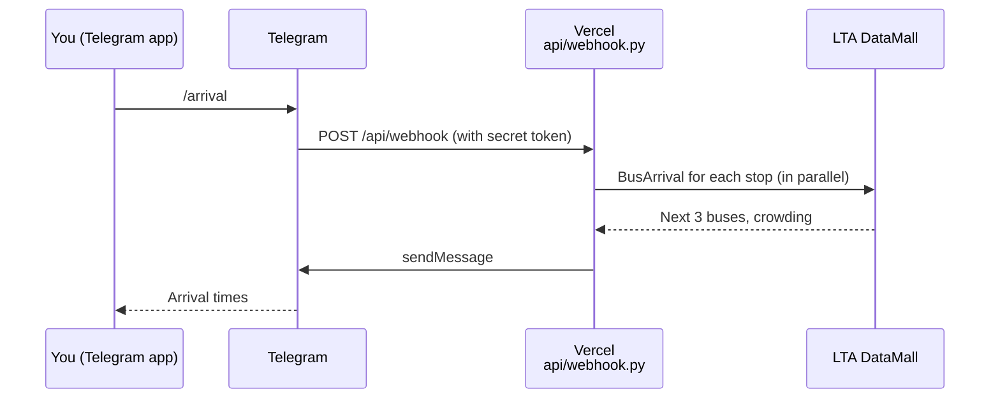
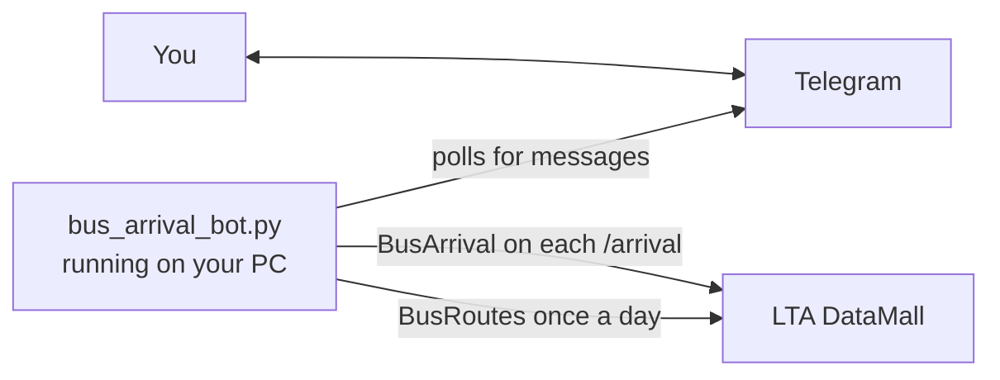

# Bus Arrival Bot

A Telegram bot that shows live bus arrival times for your chosen stops using the [LTA DataMall](https://datamall.lta.gov.sg/) Bus Arrival API (v3).

## Features

- `/arrival` shows the next 3 buses for each stop (send it again for new times)
- `/clear` deletes recent messages in the chat (Telegram only allows deleting messages under 48 hours old)
- `/menu` lists what each command does
- Crowding shown as 🟢 seats, 🟡 standing, 🔴 limited
- 🕒 marks times taken from the timetable instead of live GPS
- Outside operating hours it shows "Not in operation, first bus HH:MM"
- Always uses Singapore time (UTC+8), even on an overseas server
- Your stops are kept in an environment variable, not in the code

## Architecture

There are two versions of the bot. They share the same logic but receive messages differently.

### Vercel version (webhook)

Nothing runs until a message arrives. Telegram calls the Vercel function, which fetches arrival times, replies, and exits.



First/last bus times don't change often, so they aren't fetched on every message. You run `python api/webhook.py` on your PC once. It downloads the times from LTA's BusRoutes and stores them inside the `WATCHLIST` variable you paste into Vercel.

### Local version (polling)

`bus_arrival_bot.py` runs all the time and keeps asking Telegram for new messages. It downloads first/last bus times itself, once a day.



### How `/clear` works

In a private chat, every message (yours and the bot's) gets the next number in one sequence. `/clear` deletes the 300 numbers before it, in batches of 100. The bot doesn't need to remember what it sent, which matters on Vercel, where nothing is saved between messages.

## Project structure

```
.
├── api/
│   └── webhook.py        # Vercel serverless version (webhook)
├── bus_arrival_bot.py    # Long-running version (polling), for your PC or a server
├── pyproject.toml        # Tells Vercel where the webhook entrypoint is
├── requirements.txt
├── .env                  # Your keys and stops (don't commit this)
└── README.md
```

## Prerequisites

- Python 3.10+
- A Telegram bot token from [@BotFather](https://t.me/BotFather)
- An LTA DataMall API key ([request one here](https://datamall.lta.gov.sg/content/datamall/en/request-for-api.html))

## Setup

1. Install the dependencies:

   ```bash
   pip install -r requirements.txt
   ```

2. Create a `.env` file in the project folder:

   ```env
   TELEGRAM_TOKEN=your-telegram-bot-token
   LTA_API_KEY=your-lta-datamall-key
   WATCHLIST='[{"stop":"12345","name":"Home","service":"10"},{"stop":"67890","name":"Work","service":"20"}]'
   ```

   Each entry in `WATCHLIST` has:

   | Field     | Meaning                                          |
   | --------- | ------------------------------------------------ |
   | `stop`    | 5-digit bus stop code (printed on the stop sign) |
   | `name`    | Label shown in the bot                           |
   | `service` | Bus number to show at that stop                  |

   Keep `WATCHLIST` on a single line.

## Option A: run locally (polling)

```bash
python bus_arrival_bot.py
```

Then send `/arrival` to your bot in Telegram. The bot only responds while the script is running.

## Option B: deploy to Vercel (webhook)

1. Get the `WATCHLIST` value for Vercel by running this on your PC:

   ```bash
   python api/webhook.py
   ```

   It reads your stops from `.env`, adds their first/last bus times, and prints a line to copy.

2. In [Vercel](https://vercel.com/), click **Add New → Project** and import this GitHub repo.
3. In the Vercel project settings, add these environment variables:
   - `TELEGRAM_TOKEN`
   - `LTA_API_KEY`
   - `WATCHLIST`: paste the line from step 1 (no quotes around it)
4. Deploy, then open this URL once to connect Telegram to your deployment:

   ```
   https://<your-project>.vercel.app/api/webhook?setup
   ```

   Use your production domain (**Settings → Domains**), not a deployment URL with a random hash like `<project>-8b2ybvio7-<team>.vercel.app`. Deployment URLs sit behind Vercel's login, so Telegram can't reach them.

   You should see "✅ Connected!". This also adds `/arrival`, `/clear` and `/menu` to Telegram's command menu. Run it again whenever you add or rename a command.

5. Send `/arrival` to your bot.

You only need to do step 4 once. Pushing to `main` redeploys to the same domain, and the bot picks up the new code automatically.

The webhook rejects any request that doesn't carry a secret token. The secret is derived from your bot token, so there's nothing extra to configure.

> **Note:** Telegram sends a bot's updates either by polling or to a webhook, not both. Starting `bus_arrival_bot.py` removes the webhook, so the Vercel bot stops replying. To switch back, open `?setup` again.

## Changing the stops

Edit `WATCHLIST` in `.env`. The polling version picks up the change the next time you start it.

For the Vercel version, run `python api/webhook.py` again. Paste the new line into Vercel's `WATCHLIST` variable, then redeploy. Do the same if LTA changes the bus schedule.

## Data source

Arrival times and bus routes come from LTA DataMall. Times are rounded down to the minute, as LTA recommends.
